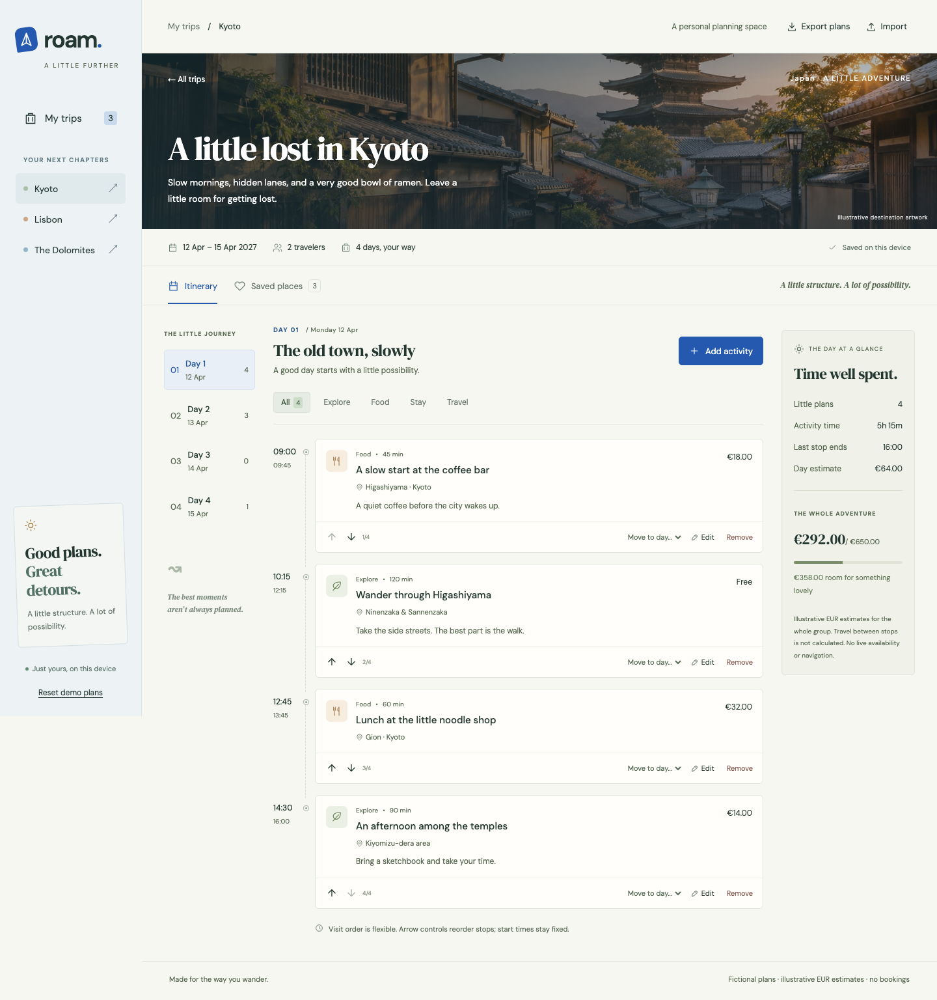
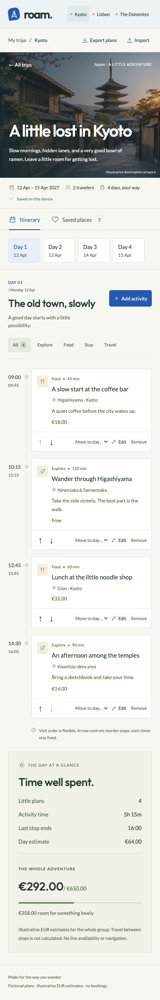

# Roam

A little structure. A lot of possibility.

An original, app-first itinerary planner created in **November 2026** for a frontend engineering portfolio. Shape three fictional adventures through Kyoto, Lisbon and the Dolomites, with a clear daily timeline and a private planning space on your device.



**[Verified live demo](https://khalilbenali1.github.io/roam-sveltekit/)**. **[Source](https://github.com/khalilBenAli1/roam-sveltekit)**

## Make a day your own

- Add and edit activities with explicit times, durations, categories, places and notes.
- Change visit order with mouse or keyboard controls. Move a stop between days; both daily schedules and estimates update.
- Spot overlapping times, filter categories and fill a blank day from destination-specific saved places.
- Read day and trip totals calculated in integer EUR cents. All estimates are illustrative group totals, with no live pricing.
- Undo up to twenty changes, including removal, import and reset, during your current visit.
- Keep validated versioned plans locally, export all plans as JSON, or import a validated backup up to 300 KB.
- Recover from malformed or blocked storage with clear feedback. Unreadable data is preserved until explicit replacement.
- Reload offline after a complete initial cache installation. No accounts, keys, paid services or runtime backend.

Start with any trip, select a day, and choose **Add activity**. The arrow controls change visit order while keeping explicit start times. **Move to day…** transfers the activity. The status message offers **Undo**. **Export plans** saves a backup; **Import** restores a version 1 export. **Reset demo plans** asks before replacing all three plans and can be undone during the visit.

## Run locally

Use **Node 22.23.1** and **npm 10.9.8**. Exact dependencies are committed in package-lock.json.

```sh
nvm use
npm ci
npm run dev
```

Open [http://127.0.0.1:4186/roam-sveltekit/](http://127.0.0.1:4186/roam-sveltekit/). The GitHub project base is intentional in development and production. For production: `npm run build`, then `npm run preview`. Restart an existing preview after rebuilding so its in-memory route manifest matches the output.

```sh
npm run lint
npm run format:check
npm run typecheck
npm test
npm run build
npx playwright install chromium webkit
npm run test:e2e
```

`npm run check` combines lint, formatting, strict type checks, unit tests and build. CI installs browser dependencies, runs the Chromium/WebKit journeys, and publishes GitHub Pages only from a passing main branch. Feature work is delivered through PRs with history-preserving merges.

## Stack and decisions

Svelte 5.57.3, SvelteKit 3.1.1, adapter-static 4.0.1, Vite 8.3.5 and TypeScript 6.0.3; native CSS and Svelte reactivity. TypeScript 6 satisfies Kit 3 and the current ESLint tooling. No additional application state framework is needed. Outfit + Lato are self-hosted OFL fonts; all three destination photographs are original generated illustrative artwork.

See [architecture and data ownership](docs/ARCHITECTURE.md), [asset provenance](ASSETS.md), [quality evidence and measured payloads](docs/QA.md), and [implementation plan](docs/PLAN.md).



## Scope

These are fictional demonstration plans, not travel advice or live quotes. No bookings, routing or availability checks occur. Prices use EUR for comparison rather than claiming local costs. Activity times stay within a single calendar day. Plans stay in this browser; export for backup. Undo is memory-only, and local data does not sync between tabs or devices. No personal/contact/payment information is requested. Accessibility scans are evidence, not certification; real-device screen-reader testing remains outside this demo’s verification.

Original code: [MIT](LICENSE). Fonts retain their included [OFL notices](docs/licenses); artwork provenance and licensing scope are in [ASSETS.md](ASSETS.md).
